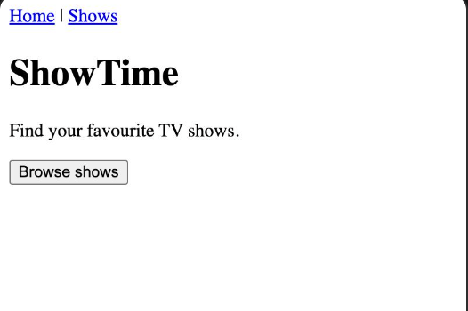
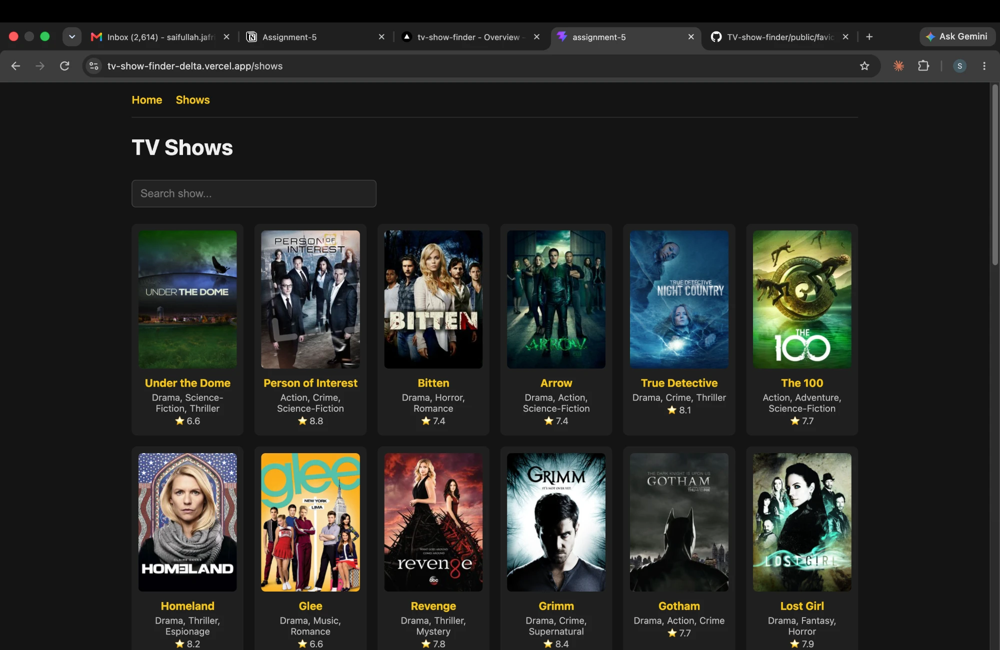

# ps6-tv-show-finder

**PS number:** PS6
**Project name:** ShowTime, a TV show finder
**API used:** [TVmaze API](https://www.tvmaze.com/api)
**Live link:** https://tv-show-finder-delta.vercel.app/

A React app to browse TV shows, search them by name, and open a detail page with the cast.

## Routes

| Route | Page shows | API |
|---|---|---|
| `/` | Hero and "Browse shows" button | none |
| `/shows` | First 40 shows as cards (poster, name, genres, rating) with search by name | `https://api.tvmaze.com/shows?page=0` |
| `/shows/:id` | Poster, name, genres, language, premiere date, rating, summary and cast | `https://api.tvmaze.com/shows/:id` and `/shows/:id/cast` |
| `*` | "Page not found" with a link to Home | none |

## Screenshots

Before styling (home page):



After styling (shows page):



## Run locally

```bash
npm install
npm run dev
```

Built with React, Vite and React Router. Deployed on Vercel (`vercel.json` rewrites all paths to `index.html` so detail URLs work on refresh).
